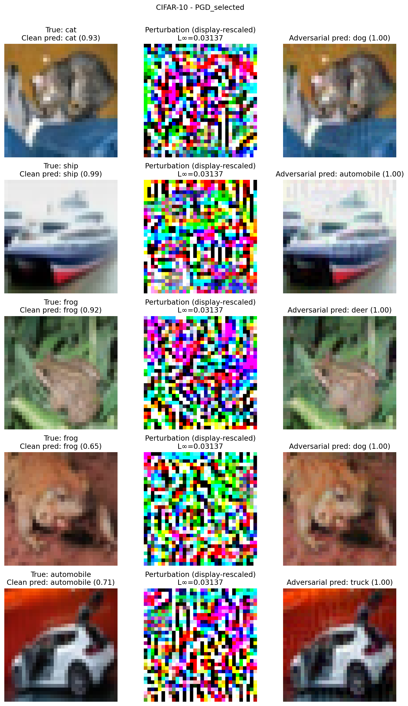
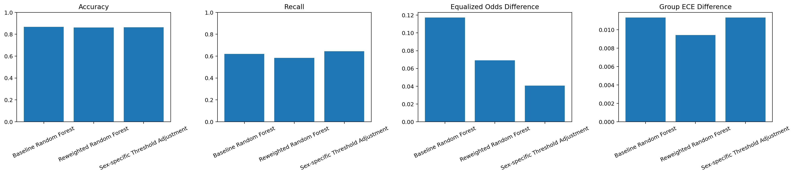

# Auditing Adversarial Robustness, Fairness, and Explainability

These are two end-to-end audits from the practical part of a trustworthy-ML assignment:

1. **Adversarial robustness** (`q5_adversarial_robustness.ipynb`): attacks and adversarial training on Fashion-MNIST and CIFAR-10. Gradient masking is checked with several independent attacks before any robustness claim is made, and TCAV concept tests are applied to both baseline and robust models.
2. **Fairness and explainability** (`q6_fairness_explainability.ipynb`): group-fairness, calibration, SHAP and counterfactual analysis of income classifiers on Adult Income, followed by two bias-mitigation methods and their trade-offs.

Assignment 3 for **Trustworthy Machine Learning** (Dr. Maryam Amirmazlaghani), Amirkabir University of Technology, Spring 2026.

## 1. Adversarial robustness

**Setup:** a compact CNN on Fashion-MNIST and ResNet-18 on CIFAR-10. FGSM and PGD (random start, restarts) are implemented from scratch, and PGD step size and step count are chosen on a held-out validation split. Two defenses are compared: random-start FGSM adversarial training and PGD-7 adversarial training.

**Gradient-masking audit:** strong PGD (40 steps × 5 restarts), EOT-PGD, transfer attacks from an independently trained surrogate, and the standard AutoAttack suite (APGD-CE, APGD-T, FAB-T, Square). Every attack runs on the full 10k test set.

Results under an L∞ budget of ε = 8/255 for both datasets:

| Dataset | Model | Clean | FGSM | PGD | Strong PGD | EOT-PGD | AutoAttack |
|---|---|---|---|---|---|---|---|
| Fashion-MNIST | Baseline | 89.3 | 66.6 | 63.4 | 62.7 | 62.8 | 62.7 |
| | FGSM-AT | 88.7 | 78.5 | 77.0 | 76.6 | 76.7 | 76.4 |
| | PGD-AT | 87.7 | 79.7 | 78.7 | 78.5 | 78.6 | **78.2** |
| CIFAR-10 | Baseline | 80.8 | 4.2 | 0.0 | 0.0 | 0.0 | 0.0 |
| | FGSM-AT | 67.6 | 31.6 | 25.8 | 24.6 | 24.6 | 21.7 |
| | PGD-AT | 61.3 | 37.0 | 34.8 | 34.4 | 34.4 | **30.7** |

Accuracy is in %, on the full test set. The FGSM sweep from ε = 0 to 16/255 is in `results/q5_adversarial_robustness/full/<dataset>/baseline/fgsm_sweep.csv`.

- Robust accuracy stays nearly the same from PGD through EOT-PGD to AutoAttack, and EOT adds nothing over ordinary PGD. Neither defense shows signs of gradient masking.
- On CIFAR-10, PGD-AT gives about 9 points more AutoAttack accuracy than FGSM-AT. It costs 6 points of clean accuracy and twice the training time.
- TCAV shows that the PGD-trained Fashion-MNIST model is less sensitive to the *footwear* concept for T-shirts than the baseline. Per the notebook's own caution, this measures sensitivity, not causal reasoning.



## 2. Fairness, explainability, and mitigation (Adult Income)

| Model | Accuracy | F1 | ROC-AUC | Demographic-parity gap (sex) | Equal-opportunity gap (sex) |
|---|---|---|---|---|---|
| Logistic regression | 85.1 | 0.659 | 0.903 | 0.188 | 0.142 |
| Random forest | 86.7 | 0.690 | 0.917 | 0.174 | 0.117 |
| RF + reweighing | 86.1 | 0.668 | 0.914 | **0.106** | 0.069 |
| RF + sex-specific thresholds | 86.3 | **0.693** | 0.917 | 0.128 | **0.041** |

- The fairness gaps are much larger for sex × race intersections (equal-opportunity gap up to 0.42 for logistic regression) than for either attribute alone.
- Dropping the sensitive attributes does not remove the gaps, because proxy features still carry the information.
- Both mitigations shrink the gaps at a cost of less than 1 point of accuracy. However, both widen the predictive-parity gap (0.003 → about 0.15), so improving one fairness criterion worsens another.
- The leveling-down check shows the two methods work differently. Reweighing partly closes the gap by lowering the male true-positive rate (63.8% → 57.4%). Threshold adjustment raises the female rate (52.0% → 67.8%) and leaves males unchanged.
- Explanations include permutation importance, partial dependence, global and local SHAP (with an additivity check), and actionable counterfactuals that leave sex, race and age fixed.



## Repository structure

```text
.
├── q5_adversarial_robustness.ipynb
├── q6_fairness_explainability.ipynb
├── results/
│   ├── q5_adversarial_robustness/full/   # per-dataset tables, figures, audit results, REPORT_* summaries
│   └── q6_fairness/                      # fairness, calibration, SHAP, counterfactual, mitigation outputs
├── requirements.txt
└── report/report_fa.pdf                  # Full report (Persian)
```

Model checkpoints and TCAV activation caches are not committed. Re-running the notebook regenerates them.

## Running

```bash
pip install -r requirements.txt     # pins torch 2.6 + CUDA 12.6
jupyter lab
```

- Run both notebooks from the repository root. Datasets download automatically into `data/`.
- `q5` defaults to `EXECUTION_MODE = "full"`. The reported runs used an RTX 3090 (24 GB), with batch sizes of 2048 for Fashion-MNIST and 1024 for CIFAR-10. Set it to `"development"` for a quick check of the code.
- Seed 42 everywhere. Attack and mitigation hyperparameters were chosen on validation data, never on the test set.

## License

[MIT](LICENSE)
